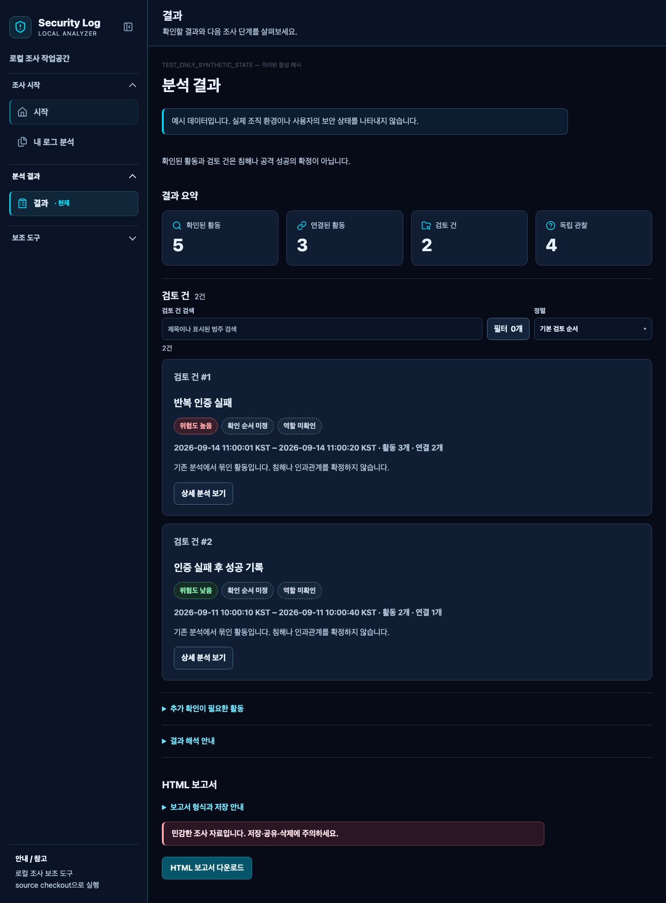

# AI Security Log Analyzer

인증·웹 접근 로그에서 조사할 관찰과 근거를 정리하는 **방어 목적의 로컬 조사 보조 도구**입니다.

application·OpenSSH·웹 access 로그를 입력하면 형식 인식 범위, 결정적 탐지, 지원 관계, 위험도, 검토 건과 보고서를 한 작업 화면에서 확인할 수 있습니다. 탐지와 관계는 침해·공격 성공·인과관계의 확정이 아닙니다.



_합성 예시입니다. 실제 조직 환경이나 사용자의 보안 상태를 나타내지 않습니다._

## 한눈에 보는 흐름

**파일·텍스트 입력 → 입력 품질 → 탐지 → 관계·위험도 → 검토 건 → 활동 흐름·확인할 작업 → 보고서**

- **로컬 우선 분석** — 기본 분석과 고정 frontend는 loopback에서 실행되며 외부 LLM을 호출하지 않습니다.
- **지원 입력** — application 인증, 제한된 OpenSSH 인증, 웹 access와 별도 Linux Audit 흐름을 다룹니다.
- **입력 품질** — 인식·미인식·제외된 줄을 탐지 결과와 분리해 보여줍니다.
- **설명 가능한 결과** — 관찰 근거, 지원 관계, 위험도와 한계를 구분합니다.
- **조사 작업공간** — 검토 큐, 활동 흐름, 명시적으로 요청하는 확인할 작업을 제공합니다.
- **제한된 공개 출력** — 개인정보를 제한한 API projection과 HTML 보고서를 제공합니다.

## 빠른 시작

macOS 또는 Linux의 **Python 3.12 이상** 환경에서 [uv](https://docs.astral.sh/uv/)로 실행합니다.

```bash
git clone https://github.com/misosos/ai-security-log-analyzer.git
cd ai-security-log-analyzer
uv sync --locked --dev
uv run python -m app.local_web
```

`http://127.0.0.1:8000/`을 열고 예시 데이터 또는 직접 고른 로컬 로그를 분석합니다. 터미널에서 `Ctrl+C`로 종료하십시오. 현재 공식 방식은 **source checkout**이며 wheel·PyPI와 standalone 다운로드는 지원하지 않습니다. 포트 포워딩하거나 인터넷에 공개하지 마십시오. 자세한 첫 실행은 [로컬 웹 시연 안내](docs/final_demo_guide.md)를 따르십시오.

## 실시간 모니터링

```bash
uv run python -m app.monitor_setup
uv run python -m app.local_web --monitor
```

| 옵션 | 동작 |
| --- | --- |
| `uv run python -m app.monitor_setup --multi-source` | application+SSH private v3 마법사 설정 생성 |
| `uv run python -m app.monitor_setup --show` | 경로를 숨긴 설정·checkpoint 요약 |
| `uv run python -m app.monitor_setup --delete` | 승인 후 설정·checkpoint 삭제; 원본 로그 보존 |
| `uv run python -m app.monitor_setup --reset-checkpoint` | 승인 후 새 epoch 시작; 원본 로그·설정 보존 |
| `uv run python -m app.monitor_setup --reset-checkpoint --role application\|ssh\|all` | v3 복구 자료의 대상 역할 선택 |

기존 단일 설정은 **애플리케이션 로그인 로그 또는 SSH 인증 로그**, 즉 application·SSH 파일 하나를 `FROM_END`부터 읽고 bounded checkpoint로 같은 파일을 복구합니다. **Rotation·copytruncate의 자동 연결은 없습니다.** Rotation/copytruncate, cross-source 분석과 cross-source 결합 없음, exactly-once·무유실 보장 없음이 현재 경계입니다. access live는 detection-only입니다. **새 결과 N건 보기**를 눌러 대기 결과를 적용하며 **화면 표시 일시 정지**는 서버 수집을 멈추지 않습니다. [설정·checkpoint](docs/live_checkpoint_21.md) · [SSH 설정](docs/monitor_setup_ssh_30_1.md) · [SSH 재시작](docs/ssh_checkpoint_recovery_26_0.md) · [multi-source 수용](docs/multi_source_acceptance_32_4.md)

## 지원 입력

| 입력 | Batch | Live/checkpoint | 대표 관찰과 제한 |
| --- | --- | --- | --- |
| application 인증 로그 | 지원 | 단일 파일 bounded 복구 | 인증 실패·성공과 지원 관계; 로그 밖의 사실은 판단하지 않음 |
| OpenSSH 인증 로그 | 지원 | 단일 파일·private v3 | Brute Force·Spray-like; 성공 기록은 계정 탈취 증거가 아님 |
| 웹 access 로그 | 지원 | detection-only 수동 v1, checkpoint 미지원 | 요청 패턴; HTTP 응답만으로 exploit 성공을 판단하지 않음 |
| Linux Audit | 별도 조사 흐름 | 미지원 | Linux Audit 프로세스 실행 기록에서 조사 후보 category·건수 제공; 악성 실행 판정이 아님 |

탐지 유형에는 Brute Force, Password Spraying-like, Path Traversal, SQL Injection-like, XSS-like 등이 있습니다. 합성 평가 범위는 [탐지 평가](docs/detection_evaluation.md), 형식 범위는 [지원 로그 형식](docs/supported_log_format_compatibility_36_9b.md)을 참조하십시오.

## 결과를 읽는 법

- 탐지는 조사할 관찰이며 결과가 없다고 안전한 것은 아닙니다.
- 상관관계는 인과관계가 아님을 전제로 읽습니다.
- 로그인 성공은 공격 성공이 아님을, HTTP 200은 유출 성공이 아님을 유지합니다.
- 위험도, 확인 순서와 검토 상태는 서로 다른 값이며 어느 것도 침해 확정이 아닙니다.
- `reviewed`가 해결·안전·오탐 확정을 뜻하지 않음, `deferred`가 낮은 위험을 뜻하지 않음이 검토 상태 계약입니다.

## 개인정보·보안 경계

- 실제 로그는 기본 기능에서 로컬 처리하며 **외부 LLM을 호출하지 않습니다**. 기본 근거 도움말도 Gemini를 호출하지 않습니다.
- 원본 로그·credential·개인정보를 저장소나 공개 Issue에 올리지 마십시오. 취약점은 [SECURITY.md](SECURITY.md)의 비공개 경로로 신고하십시오.
- 공개 projection은 응답 안에서만 유효한 대상 별칭을 사용합니다. 별칭을 응답 간 상관 키나 영구 ID로 사용하지 마십시오. 이전 응답의 변경 사항은 [개인정보 경계](docs/public_analysis_privacy.md)에 있습니다.
- 요청 임시 자료는 정상 종료 시 정리되지만 비정상 종료 뒤 잔존할 수 있고 secure erase를 보장하지 않습니다.
- 이 도구는 SIEM·EDR·WAF·자동 대응 제품이 아닙니다. 실제 사용자 자료·조직 운영·자동 대응은 계속 `NO_GO`입니다.

## 현재 지원 수준

| 영역 | 현재 수준 |
| --- | --- |
| 실행 | macOS·Linux source checkout; Chrome/Chromium primary |
| 보조 브라우저 | Safari secondary compatibility; 모든 흐름을 검증한 것은 아님 |
| Windows | batch-only 설계 대상, 아직 `NOT_TESTED` |
| 모바일 | 반응형 Chromium 자동 검사만 수행; 실제 모바일 미지원 |
| 배포 | macOS arm64 onedir 로컬 prototype만 검증; 다운로드 artifact·installer 없음 |
| 접근성 | 자동 axe 검사는 WCAG 2.2 AA 인증을 의미하지 않음 |

<details>
<summary><strong>검증·파일럿 기록과 역사적 경계</strong></summary>

- 검토 큐의 검색·필터·정렬과 document memory 검토 상태는 분석 projection과 분리됩니다. Phase 36.14F 합성 사용자 수용은 **12/12 PASS**였고 API·SQLite·Web Storage 없음이 현재 계약입니다. [설계](docs/investigation_review_workflow_state_design_36_14a.md) · [수용 기록](docs/investigation_review_workflow_state_acceptance_36_14f.md)
- Phase 36.15A 결정은 **`STANDALONE_BUNDLE_FIRST`**입니다. Phase 36.15B는 macOS arm64 onedir 로컬 prototype만 검증했으며 다운로드 가능한 Release artifact는 미제공입니다. 서명·notarization·Windows/Linux 검증은 후속 gate입니다. [배포 설계](docs/local_first_distribution_design_36_15a.md) · [prototype 기록](docs/pyinstaller_onedir_feasibility_36_15b.md)
- Phase 33.1의 결정적 lexical retrieval은 조사 사례 안에서 사용자가 요청할 때만 citation을 표시하고 분석을 생성·변경하지 않습니다. **Embedding production 통합은 NO_GO**이며 Phase 33.2B 결론은 “production 통합은 보류합니다”입니다. Phase 33.3B·33.3C `ISOLATION_BLOCKED`, 33.3D `SUPPLY_CHAIN_BLOCKED`, 33.3E `RESOURCE_NO_GO`, 33.3F `STORAGE_SETUP_BLOCKED`; 모델 inference 없음이 경계입니다. **Local Gemini 실패 시 fallback은 없습니다.** 기존 Gemini helper는 별도 호출 시 IP가 포함된 projection을 보내고 자유 문자열을 검증 없이 반환합니다. [AI triage](docs/ai_investigation_triage_design_36_0.md) · [33.2A](docs/local_embedding_supply_chain_gate_33_2a.md) · [33.2B](docs/local_embedding_retrieval_pilot_33_2b.md) · [33.3C](docs/local_llm_pilot_33_3c.md) · [33.3D](docs/local_llm_pilot_33_3d.md) · [33.3E](docs/local_llm_artifact_closure_33_3e.md) · [33.3F](docs/local_llm_acquisition_environment_33_3f.md) · [근거 도움말](docs/local_investigation_guidance_33_4.md)
- 결정적 조사 우선순위 기준선과 citation checklist는 risk와 분리되며 명시적 사용자 요청만 사용합니다. [기준선](docs/deterministic_investigation_triage_36_1.md) · [checklist](docs/lexical_investigation_checklist_36_2.md) · [API/UI](docs/investigation_checklist_api_ui_36_3.md) · [verified role](docs/investigation_checklist_verified_role_36_4.md). Phase 36.4의 역사적 판정은 `CONDITIONAL_GO`이며 현재 운영 승인이 아닙니다.
- 작업공간 shell은 기존 UI 미대체·rollback 계약을 유지했습니다. [navigation](docs/investigation_workspace_projection_navigation_36_6b.md) · [dashboard](docs/investigation_workspace_dashboard_overview_36_6c.md). Phase 33.4A synthetic IP canary 노출은 후속 공개 projection에서 수정됐습니다.
- 자동 수집은 합성 입력의 loopback TCP Syslog pilot 범위만 검증했습니다. 원격·실제 사용자 로그 수집은 지원하지 않습니다. JSON Lines adapter core와 제한된 Ubuntu acceptance만 통과했고 실제 사용자 로그 수집과 조직 운영은 계속 지원하지 않습니다. Vector 0.60.0 archive는 정적 검사만 완료했고 ARM64 미실행·`USER_ACTION_REQUIRED`/`ISOLATION_BLOCKED`, config/wire `NOT_TESTED`, credential 형태 문자열 3건 `UNRESOLVED`입니다. Vector 실제 연동·Vector 실행은 `NO_GO`입니다. [collector](docs/automatic_log_collection_design_34_0.md) · [management acceptance](docs/loopback_tcp_syslog_management_acceptance_34_5.md) · [pair 안정성](docs/pair_truncation_stability_35_4a1.md) · [Vector](docs/vector_isolated_integration_plan_35_4.md)
- 공개 HTML 보고서는 제한된 projection을 사용합니다. [제한된 내부 조사 보고서](docs/trusted_analyst_report_design_33_5a.md)와 [합성 pilot](docs/trusted_analyst_report_pilot_33_5b.md)은 실제 사용자 자료 export·조직 운영 미승인입니다. 파일은 자동 암호화되지 않습니다.
- 공개 개인정보 회귀와 이전 응답 migration은 [Phase 33.4B](docs/public_investigation_privacy_33_4b.md), Safari 범위는 [33.4C](docs/public_investigation_privacy_acceptance_33_4c.md)에 기록했습니다. 작업공간·입력 품질 검수는 합성 범위입니다. [입력 품질](docs/input_quality_summary_backend_core_36_12a.md) · [문서 지도](docs/index.md)
- [v0.4.0 노트](docs/releases/v0.4.0.md)는 로컬 릴리스 기록이며 [v0.3.0 노트](docs/releases/v0.3.0.md), [v0.3.0 Release](https://github.com/misosos/ai-security-log-analyzer/releases/tag/v0.3.0), [Safari 기록](docs/v030_safari_acceptance_27_1.md)은 이전 기록입니다. 역사적 `CONDITIONAL_GO`는 현재 Production·hosted·조직 운영 승인이 아닙니다.

</details>

## 개발·문서·라이선스

```bash
uv run pytest
uv run python -m app.evaluation
npm ci --ignore-scripts --no-audit --no-fund
npm run test:a11y
```

평가는 작은 합성 시나리오의 고정 기대 결과이며 실제 운영환경 탐지율이 아닙니다. [문서 지도](docs/index.md) · [시연 안내](docs/final_demo_guide.md) · [탐지 평가](docs/detection_evaluation.md) · [개인정보](docs/public_analysis_privacy.md) · [변경 이력](CHANGELOG.md) · [보안 신고](SECURITY.md) · [MIT License](LICENSE)
